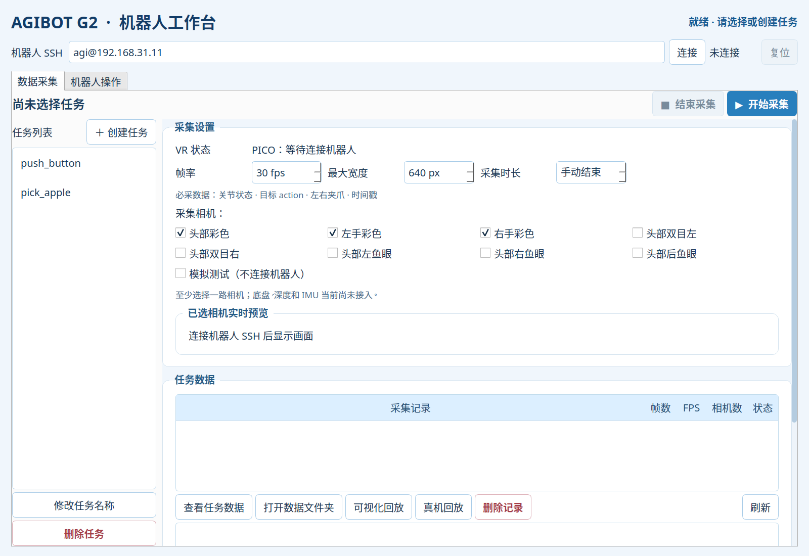
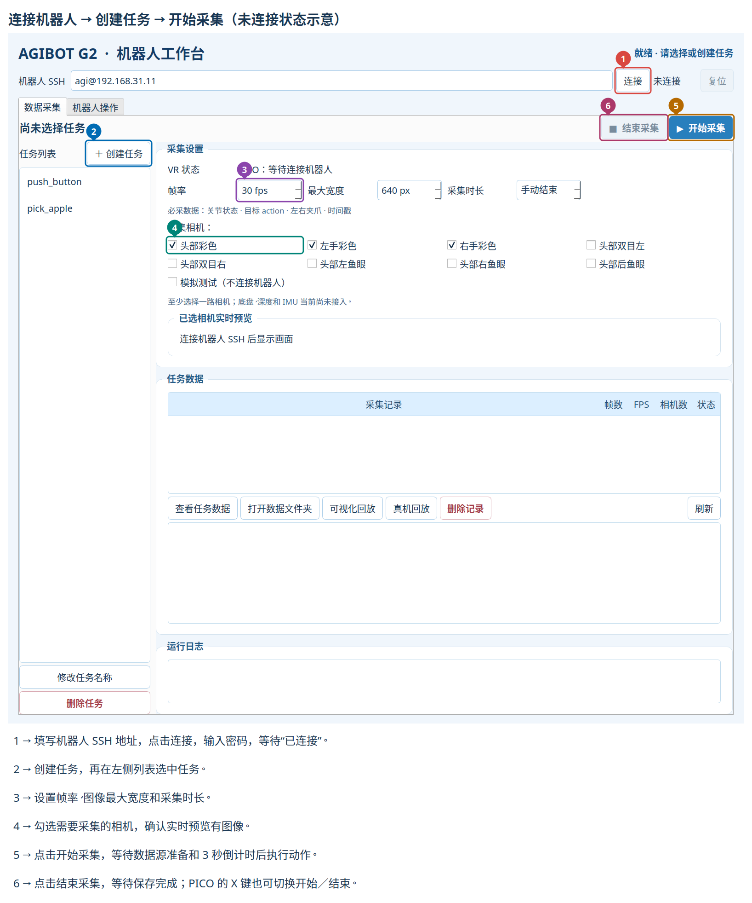
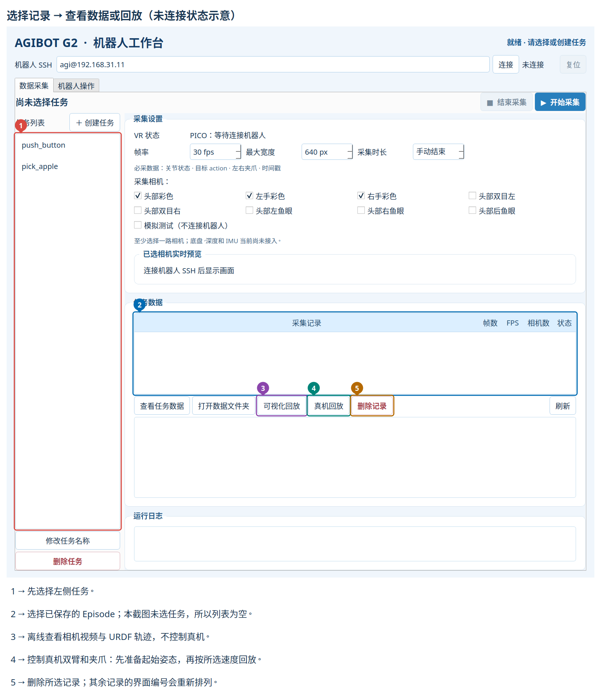
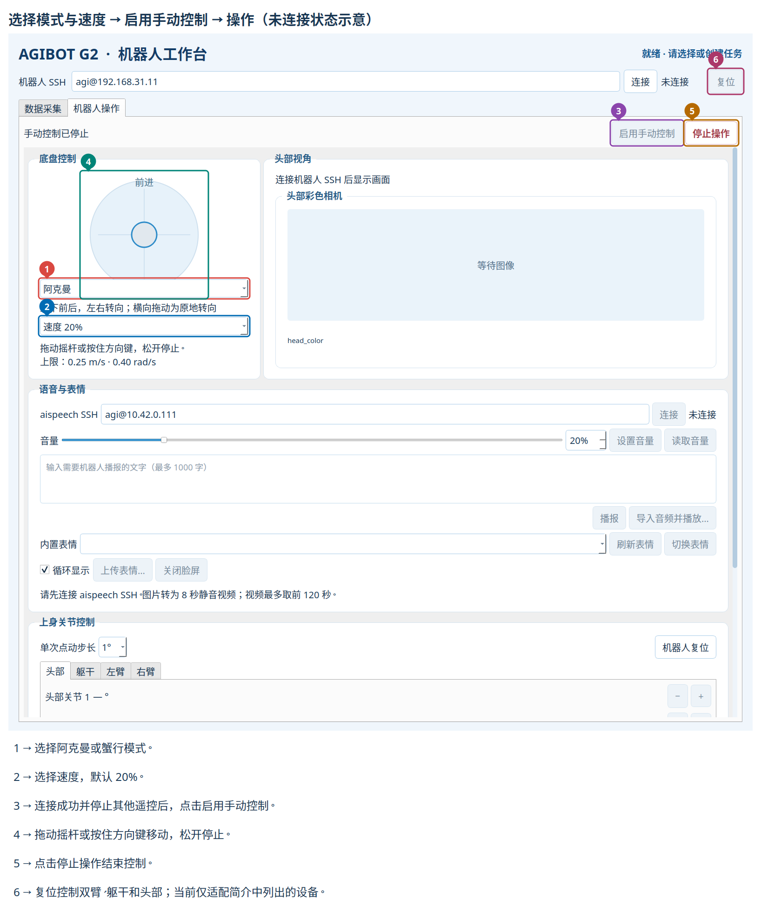
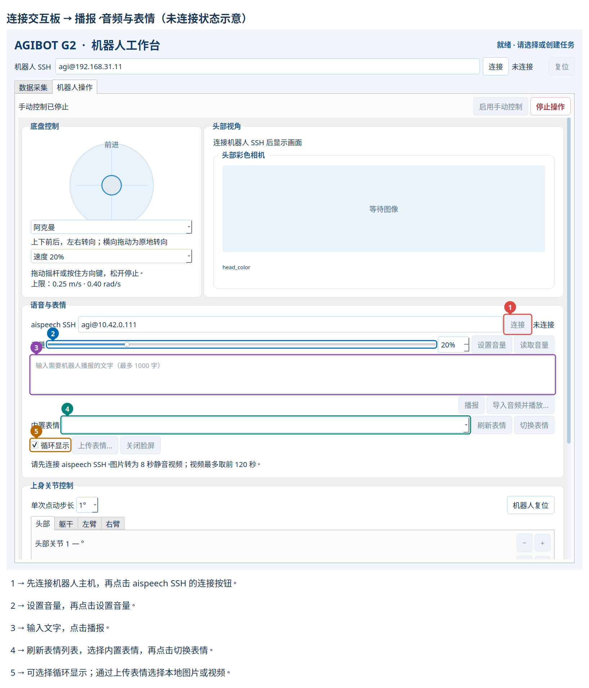

# Agibot G2 机器人工作台

## 一、简介



　　这个项目是用于智元精灵 G2 的 **Qt GUI桌面工作台**，界面分为“数据采集”和“机器人操作”两个分页。电脑通过 SSH 连接机器人，在机器人本机调用 GDK，完成数据读取、动作控制和状态反馈。

　　制作该GUI界面的原因是官方的Genie Link离线采集数据会默认保存数据到机器人上，而且默认使用Genie Studio自己的数据格式，不能定义采集数据的格式。所以制作了这个GUI，操作界面采集的数据直接保存为电脑上的 **LeRobot v3.0 数据集**，不需要先导出 `.pbdat` 再转换。下面是这个GUI的基本功能：

| 功能 | 内容 |
| --- | --- |
| 数据采集 | 创建、重命名和删除任务，选择相机，开始与结束采集，查看采集记录 |
| VR 按键 | 接收 Genie Link 的左手柄 X 键信号，切换开始／停止采集 |
| 可视化回放 | 查看采集视频、G2 URDF 关节轨迹和夹爪状态，不控制真机 |
| 真机回放 | 对照采集画面与实时画面，回放双臂和夹爪动作，可选择速度 |
| 手动控制 | 鼠标摇杆和方向键控制底盘，支持阿克曼、蟹行；上身关节点动 |
| 独立复位 | 通过 GDK 规划复位，无需启动 VR；检查实测关节是否到位 |
| 语音与表情 | 设置音量、文字播报、导入音频、切换内置表情和上传图片／视频 |

　　默认连接方式如下，**SSH 地址是机器人主机地址，数据集写入电脑磁盘**：

```text
电脑：Qt 界面、任务管理、LeRobot 写入器
                 ↕ SSH
机器人主机：GDK 数据读取、运动控制
                 ↕ 内部网络
头部交互板：语音、音频、脸屏表情
```

　　当前独立复位已核实的设备为 `G2A0005C600872`，使用 `G2_t2v2_crs` 配置及 OmniPicker 夹爪对应的 pose 11。**其他机器人不能直接套用这个复位配置**，程序会校验设备身份和夹爪型号。

## 二、环境安装

### 1. 下载项目

```bash
git clone https://github.com/pengxiang-lu/agibot-g2-gui.git
cd agibot-g2-gui
```

　　下文命令默认在项目根目录 `agibot-g2-gui/` 中执行。已有项目时，进入自己的项目目录即可。

　　目录名可以修改，两个启动脚本会自动定位自身目录；如果使用桌面快捷方式，移动或重命名项目后，需要同步修改 `.desktop` 文件中的 `Exec`、`Path` 和 `Icon`。

### 2. 准备电脑环境

　　当前主要面向 **Ubuntu 24.04**，其他 Linux 发行版尚未验证，Windows 和 macOS 尚未适配。请先安装 Conda，再准备以下 Python 环境。

　　当前代码以 **Python 3.12、LeRobot 0.6.2** 为基准。采集器使用了该版本的流式视频写入接口，并在启动时检查版本，不能直接换成其他版本。

| 组件 | 用途／版本要求 |
| --- | --- |
| Python | 3.12，已验证版本为 3.12.13 |
| LeRobot | 0.6.2，从匹配的源码目录以 editable 方式安装 |
| PyQt5 | Qt 5 图形界面 |
| VTK | URDF 模型显示 |
| NumPy、OpenCV、PyArrow、PyAV | 数值处理、图像处理、Parquet 和视频读写 |
| OpenSSH、FFmpeg | 连接机器人、媒体转码 |

　　首先安装系统工具：

```bash
sudo apt update
sudo apt install -y git openssh-client ffmpeg libgl1 libegl1 libxcb-xinerama0
```

　　如果是新环境，创建 Python 3.12 环境；已经有满足依赖要求的 `lerobot` 环境时，直接激活即可，不需要重复创建。

```bash
conda create -n lerobot python=3.12 -y
conda activate lerobot
```

　　从 [LeRobot 官方仓库](https://github.com/huggingface/lerobot) 下载源码。官方没有 `v0.6.2` 标签，因此不能使用 `git clone --branch v0.6.2`；下面固定到版本号为 `0.6.2` 的源码提交，避免直接安装持续变化的 `main` 分支。

　　在本项目根目录执行以下命令，将 LeRobot 下载到项目的同级目录：

```bash
git clone https://github.com/huggingface/lerobot.git ../lerobot
git -C ../lerobot checkout --detach f9e9d739ea7055b282ea1b165e8785412a674693
python -m pip install -e "../lerobot"
python -m pip install "av>=15,<16" pyarrow PyQt5 vtk PyYAML
```

　　如果 `../lerobot` 已存在，请选择一个新的下载目录，并同步修改后续命令中的路径，避免影响已有源码和环境。安装后不要删除或移动 LeRobot 源码目录，editable 安装会直接引用它。

　　安装后检查依赖：

```bash
python - <<'PY'
import importlib.metadata as metadata
import numpy, cv2, pyarrow, av
from PyQt5 import QtCore
import vtk
from lerobot.datasets.lerobot_dataset import LeRobotDataset
from lerobot.configs.video import RGBEncoderConfig
assert metadata.version("lerobot") == "0.6.2"
print("LeRobot:", metadata.version("lerobot"))
print("Qt:", QtCore.QT_VERSION_STR)
print("VTK:", vtk.vtkVersion.GetVTKVersion())
PY
ffmpeg -version
```

　　**采集视频使用 CPU 流式编码，不要求使用 GPU**。同时运行模型评测时，仍需留意 CPU、磁盘和网络带宽。以上步骤尚未在全新系统上完成完整安装验证。

### 3. 准备机器人连接

　　==电脑与机器人可通过网线或同一局域网通信==。下面的 IP 仅为连接示例，使用时请替换为自己机器人平板显示的实际地址：

| 连接方式 | 机器人地址示例 | 电脑端要求 |
| --- | --- | --- |
| 无线局域网 | `192.168.31.11` | 与机器人可互通，检查是否存在无线客户端隔离 |
| 10G 有线口 | `10.42.1.101` | 例如配置为 `10.42.1.102/24`，避免地址冲突 |

```bash
# 查看电脑到机器人的实际路由
ip route get 192.168.31.11

# 检查 SSH 登录；密码使用这台机器人对应账号的密码
ssh agi@192.168.31.11
```

　　语音和表情另外使用头部交互板的 SSH，默认地址为 `agi@10.42.0.111`，经机器人主机转发。**主机与交互板使用各自的登录凭据**，密码不写入项目文件。

## 三、使用方法

### 1. 启动工作台

```bash
# 请先进入克隆得到的 agibot-g2-gui 项目根目录
conda activate lerobot
export LEROBOT_PYTHON="$CONDA_PREFIX/bin/python"
bash start_gui.sh
```

　　启动脚本默认使用 `$HOME/anaconda3/envs/lerobot/bin/python`。如果 Conda 安装位置不同，通过 `LEROBOT_PYTHON` 指定实际解释器。命令行采集的 `run.sh` 也使用同一变量。

　　在界面顶部填写机器人 SSH 地址，点击“连接”，输入密码，等待显示“已连接”。同一界面会话复用 SSH 连接；网络中断、机器人重启或会话失效后需要重新连接。

### 2. 创建任务和采集数据



### 3. 查看数据格式和保存位置


　　每次 GUI 采集创建一个独立的 LeRobot 数据集，默认保存在项目下：

```text
gui_tasks/
└── <任务ID>/
    ├── task.json
    └── recordings/
        └── <采集时间_ID>/
            ├── meta/
            ├── data/
            ├── videos/
            └── capture_manifest.json
```

| 字段 | 含义 |
| --- | --- |
| `observation.state` | 实测关节角，单位 rad |
| `action` | `/hal/joint_cmd.position` 中的绝对目标关节角，单位 rad |
| `observation.gripper` | 左、右夹爪实测位置，单位 rad |
| `observation.images.*` | 所选相机的图像，保存为 MP4 |
| `source_timestamp_ns`、`state_timestamp_ns`、`action_timestamp_ns` | 采样、状态和指令时间戳 |
| `camera_timestamp_ns.*`、`gripper_*_timestamp_ns` | 相机与夹爪时间戳 |

　　**action 不是关节角增量，也不是下一帧 state**。例如目标从 `0.5 rad` 变为 `0.6 rad`，保存的是绝对角度，而不是 `+0.1 rad`。夹爪目前采集实测位置，没有采集夹爪目标命令；底盘位姿、深度、IMU、雷达和力矩没有写入这些采集字段。

　　界面任务目录使用唯一 ID，任务名保存在 `task.json`。删除记录后，界面 Episode 编号按剩余顺序重排；每个独立数据集内部的 episode 从 0 开始。修改任务名不会重写历史数据的任务描述。

　　数据流异常时，程序会尽量保存已完成的有效帧，并在 `capture_manifest.json` 中记录中断原因。它不等于一次完整成功的采集，使用前需要检查记录状态。

### 4. 可视化与真机回放



### 5. 机器人手动操作与复位



### 6. 语音、音频和表情


